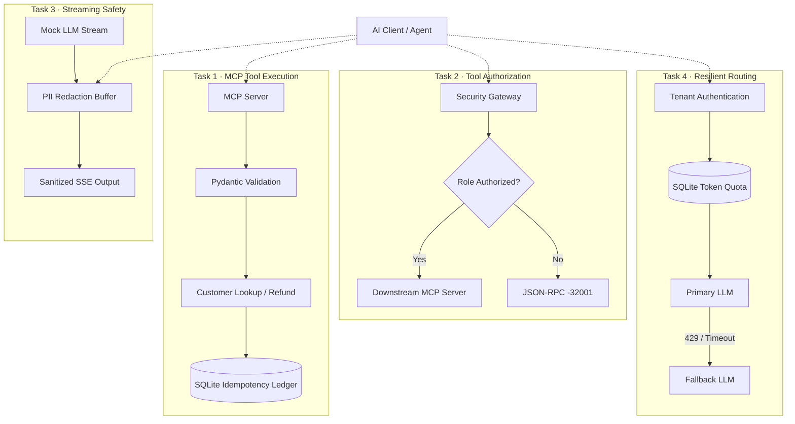
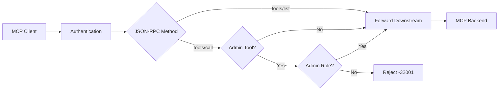
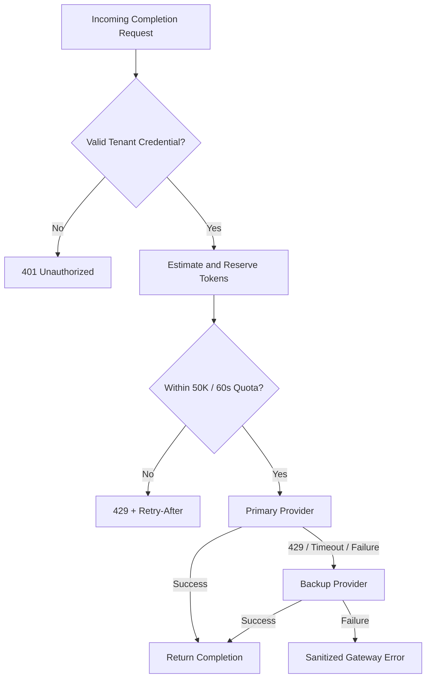

# Quilr AI | AI Field Developer Technical Assessment

Building reliable AI infrastructure through secure tool execution, streaming safety, and resilient model routing.

**Candidate:** Tanvica Samudrala  
**Role:** AI Field Developer  
**Language:** Python  
**Core Technologies:** MCP SDK, FastAPI, Pydantic, SQLite, HTTPX, asyncio, JSON-RPC 2.0, Server-Sent Events (SSE)

---

## Overview

This repository contains my implementations of four AI infrastructure challenges:
1. A custom MCP server with strict schema validation and refund idempotency.
2. An MCP security gateway enforcing role-based tool authorization.
3. A streaming PII guardrail for real-time LLM responses.
4. A token-aware rate limiter with resilient model-provider fallback.

My goal was to go beyond implementing the expected functionality and examine how each component behaves when inputs are malformed, requests arrive concurrently, streams are interrupted, or external services fail.

I approached these challenges through three engineering principles:
1. **Enforce correctness at system boundaries.**  
   Validate inputs before execution, authorize actions before forwarding requests, and preserve protocol-level error contracts.
2. **Design for predictable failure behavior.**  
   Handle retries, concurrency, partial responses, rate limits, and upstream failures without unnecessarily exposing internal implementation details.
3. **Make engineering trade-offs explicit.**  
   Use practical, reproducible components for the assessment while documenting their operational boundaries and what would change in a larger production deployment.

Each task includes implementation code, automated tests, and an Architecture Decision Record (ADR).

---

## Architecture at a Glance

The four tasks are independent implementations, each focused on a different reliability boundary in AI systems.



The implementations are intentionally separated so each component can be tested, reviewed, and evaluated independently.

---

## Quick Start

### Prerequisites
* Python 3.10 or newer, subject to the project's dependency constraints
* Git
* pip
* A local environment capable of running FastAPI services and SQLite

### 1. Clone the repository
```bash
git clone https://github.com/Tanvi1505/QuilrAI-AI-Developer.git
cd QuilrAI-AI-Developer
```

### 2. Create a virtual environment
```bash
python3 -m venv .venv
source .venv/bin/activate
```
On Windows:
```bash
.venv\Scripts\activate
```

### 3. Install dependencies
```bash
pip install -e .
```

### 4. Run the assessment tests
```bash
python -m pytest -q
```

Alternatively, use the provided task-by-task test runner:
```bash
bash run_all_tests.sh
```
The script executes the tests for all four assessment tasks individually.

The test suite uses mock services and local persistence to make the implementations reproducible without requiring access to paid LLM APIs.

> **Verification note:** Automated test results should be confirmed in the target environment. Passing the included tests demonstrates the tested behaviors, not exhaustive production certification.

---

## Implementation Summary

| Component | Core Requirement | Engineering Focus |
|---|---|---|
| **Task 1: MCP Server** | Strict validation and tool execution | JSON-RPC correctness, stdio isolation, refund idempotency |
| **Task 2: Security Gateway** | Role-based MCP tool filtering | Fail-closed authorization, downstream isolation |
| **Task 3: Streaming Guardrail** | Redact PII across streaming chunks | Boundary-safe processing, bounded buffering, streaming latency |
| **Task 4: Resilient Router** | Tenant rate limits and provider fallback | Atomic quota allocation, tenant isolation, deadline enforcement |

---

## Task 1: Custom MCP Server

**Objective:** Build a Python MCP server exposing customer lookup and refund tools with strict validation and clean stdio transport.  
**Implementation:** [MCP Server](./task1_mcp_server/server.py) | [Schemas](./task1_mcp_server/schemas.py) | [Tests](./task1_mcp_server/test_task1.py)

### Exposed Tools
* **`get_customer_record`**: Retrieves a customer record using an identifier in the required `CUST-XXXXX` format.
* **`trigger_refund`**: Processes a mock refund request with validated customer ID, positive amount, and a reason containing at least 10 characters.

### Engineering Decisions
* **Protocol correctness:** The server uses the Python MCP SDK and Pydantic validation. Invalid parameters are mapped to JSON-RPC error code `-32602`, distinguishing malformed tool inputs from valid business requests that return application-level results.
* **Strict stdio separation:** MCP communication uses `stdout` as its protocol channel. Application logs, diagnostics, and security audit events are directed to `stderr` to avoid corrupting JSON-RPC messages.
* **Persistent refund idempotency:** Refund requests can use idempotency keys to prevent repeated execution during retries. The implementation uses an SQLite ledger with WAL journaling and `BEGIN IMMEDIATE` transactions to coordinate reservations across concurrent callers sharing the same database. Reservation states distinguish in-progress execution from previously settled results.
* **Crash recovery:** A 60-second reservation TTL allows abandoned in-progress reservations to be reclaimed. This is a recovery mechanism, not an absolute exactly-once execution guarantee. In a real payment system, long-running operations would require reservation heartbeats, fencing, or downstream settlement reconciliation to prevent duplicate financial actions.

### What I Tested
The test module covers validation, idempotency behavior, and transaction-state handling. The design also accounts for concurrent requests and process-restart persistence.

### Production Considerations
For real financial transactions, I would integrate an external payment processor's idempotency contract, durable audit records, settlement reconciliation, and stronger recovery ownership semantics.

**Architecture Decision Record:** [ADR-001: MCP Transport and Validation](./task1_mcp_server/ADR-001-MCP-Transport-and-Validation.md)

---

## Task 2: MCP Security Gateway

**Objective:** Implement an HTTP JSON-RPC proxy that protects privileged MCP tools without unnecessarily changing normal downstream behavior.  
**Implementation:** [Security Gateway](./task2_security_gateway/gateway.py) | [Mock Backend](./task2_security_gateway/mock_mcp_backend.py) | [Tests](./task2_security_gateway/test_task2.py)

### Request Flow


### Engineering Decisions
* **Authorization before execution:** For `tools/call`, the gateway inspects `params.name`. Tools beginning with `admin_` require the `admin` role. Unauthorized calls are rejected with JSON-RPC error `-32001` before reaching the downstream server.
* **Strict wire parameter validation:** The gateway validates that the JSON-RPC request is a JSON object and that `params` and `name` adhere to required data types. Malformed parameter envelopes are rejected with JSON-RPC error `-32602` or `-32600` before authorization.
* **Downstream isolation:** A rejected administrative request should not cause side effects in the underlying MCP service. The tests include verification that unauthorized calls do not generate downstream requests.
* **Protocol-preserving behavior:** Permitted requests, including tool discovery through `tools/list`, are forwarded to the backend. Error responses preserve the JSON-RPC request identifier so clients can correlate requests and responses.
* **Authentication and secret isolation:** The implementation reads `JWT_SECRET` from environment variables, supporting dependency injection for automated test harnesses. When running in production mode (`ENVIRONMENT=production`), the gateway enforces explicit `JWT_SECRET` provisioning and disables demonstration pre-shared test credentials.

### Production Considerations
In a deployed environment, credentials would be managed through a secret-management system (such as GCP Secret Manager or HashiCorp Vault), with key rotation, short-lived tokens, structured audit logging, and appropriate transport security.

**Architecture Decision Record:** [ADR-002: MCP Security Gateway Proxy](./task2_security_gateway/ADR-002-MCP-Security-Gateway-Proxy.md)

---

## Task 3: Streaming PII Guardrail

**Objective:** Redact sensitive information from streamed LLM responses without requiring the complete response to be buffered.  
**Implementation:** [Streaming Redactor](./task3_streaming_guardrail/guardrail.py) | [SSE Proxy](./task3_streaming_guardrail/proxy_server.py) | [Tests](./task3_streaming_guardrail/test_task3.py)

### The Engineering Challenge
LLM providers stream partial text fragments, not necessarily complete words. For example, an email address might arrive as:
```json
["Contact ali", "ce@company.com"]
```
Applying a regular expression independently to each chunk would fail to recognize the complete email address. Buffering the entire response would make redaction simpler but undermine the purpose of streaming. The implementation uses lookahead buffering and delimiter-aware processing to balance these requirements.

### Supported PII Categories
* Email addresses
* US Social Security numbers
* Common payment-card number formats, including grouped and continuous representations

Detected values are replaced with:
`[REDACTED]`

### Engineering Decisions
* **Cross-chunk detection:** The redactor retains text that may form part of a sensitive value across multiple upstream chunks.
* **Internal whitespace handling:** SSNs and payment-card numbers may contain spaces or hyphens. The redactor evaluates these patterns across the active buffer rather than treating every space as a safe output boundary.
* **Bounded buffering & stateful token discard:** The implementation uses a configurable lookahead window and an oversized-token threshold to limit memory growth. Trailing tokens exceeding `max_unbroken_token_len` are replaced with `[REDACTED]`, and subsequent chunks belonging to the same oversized token are statefully swallowed until the next delimiter.
* **Streaming termination & failure sanitization:** Remaining buffered content is flushed when the upstream stream terminates cleanly. If the upstream provider fails or returns HTTP errors, raw server bodies and internal network topologies are kept in server logs while returning a generic `UPSTREAM_ERROR` to the client.

### Security and Performance Trade-offs
Streaming redaction introduces a fundamental trade-off between latency, memory use, and the amount of context retained for detecting sensitive values.

The implementation targets the specified PII formats. Regex-based detection does not cover every possible encoding, international identifier, or obfuscated sensitive value.

For a production deployment, I would validate adversarial chunk boundaries, malformed SSE events, oversized streams, and disconnection behavior under sustained load. I would also measure actual time-to-first-token and memory consumption before making performance guarantees.

### Production Considerations
A broader deployment could combine deterministic pattern detection with structured-data policies, configurable redaction rules, and privacy-safe monitoring.

**Architecture Decision Record:** [ADR-003: Streaming PII Guardrail](./task3_streaming_guardrail/ADR-003-Streaming-PII-Guardrail.md)

---

## Task 4: Rate Limiter and Resilient Model Router

**Objective:** Enforce a 50,000-token-per-minute quota for each tenant and automatically route requests to a backup model provider when the primary is unavailable or rate-limited.  
**Implementation:** [Rate Limiter](./task4_resilient_router/storage.py) | [Router](./task4_resilient_router/router.py) | [Gateway](./task4_resilient_router/proxy_server.py) | [Tests](./task4_resilient_router/test_task4.py)

### Request Lifecycle


### Engineering Decisions
* **Strict request shape validation:** The gateway explicitly validates that incoming payloads are JSON objects, checking that `prompt` is present, non-empty, and a string. JSON arrays, null values, numeric prompts, and missing fields return HTTP 400 before rate-limiting or routing.
* **Tenant identity from verified credentials:** The gateway resolves tenant identity from registered Bearer credentials rather than trusting arbitrary tenant identifiers supplied by callers. Unauthorized requests receive HTTP 401.
* **Server-side quota reservation:** The gateway estimates prompt usage and reserves capacity for the permitted maximum output. This prevents a caller from supplying an artificially small `requested_tokens` value to bypass quota accounting. Invalid token-count parameters are rejected before quota allocation.
* **Atomic sliding-window rate limiting:** Quota events are stored in SQLite using a rolling 60-second window. WAL journaling and `BEGIN IMMEDIATE` transactions coordinate quota checks and writes for concurrent workers sharing the same SQLite database.
* **Provider fallback:** The router attempts the primary provider first. When the primary returns a rate-limit response or exceeds the configured three-second deadline, the request is routed to a secondary provider.
* **Controlled error handling:** If routing cannot produce a successful completion, the gateway returns a structured error with a request identifier rather than exposing raw internal exception details.

### Production Considerations
SQLite is appropriate for this self-contained assessment and provides transactional behavior for workers sharing the same database file.

For a geographically distributed deployment, I would evaluate a centralized rate-limit store and coordinate quota reservations across instances. Additional operational requirements would include provider health monitoring, retry budgets, circuit breakers, actual token-usage reconciliation, and observability around fallback frequency and latency.

**Architecture Decision Record:** [ADR-004: Rate Limiter and Fallback Router](./task4_resilient_router/ADR-004-Rate-Limiter-and-Fallback-Router.md)

---

## Testing and Failure Scenarios

I organized the implementations so the four components can be evaluated independently using local mock services.

| Scenario | Expected Behavior | Relevant Task |
|---|---|---|
| Invalid customer identifier | JSON-RPC -32602 validation error | Task 1 |
| Negative refund amount | Reject before refund execution | Task 1 |
| Duplicate refund request | Reuse settled result or identify in-progress execution | Task 1 |
| Unauthorized administrative tool call | JSON-RPC -32001; no downstream execution | Task 2 |
| Authorized tool call | Forward to downstream MCP service | Task 2 |
| Email split across streaming chunks | Replace detected sensitive value with `[REDACTED]` | Task 3 |
| SSN or card number containing spaces | Detect across supported chunk boundaries | Task 3 |
| Missing final SSE marker | Process remaining buffered content at normal EOF | Task 3 |
| Invalid tenant credential | HTTP 401 | Task 4 |
| Invalid token reservation | HTTP 400 | Task 4 |
| Tenant exceeds quota | HTTP 429 with retry guidance | Task 4 |
| Primary provider returns 429 | Attempt secondary provider | Task 4 |
| Primary provider times out | Attempt secondary provider | Task 4 |
| Both providers fail | Return structured, sanitized gateway error | Task 4 |

These are the expected behaviors represented by the implementations and their tests. Actual test results should be verified by running the suite.

### Test Commands
```bash
python -m pytest task1_mcp_server/test_task1.py -v
python -m pytest task2_security_gateway/test_task2.py -v
python -m pytest task3_streaming_guardrail/test_task3.py -v
python -m pytest task4_resilient_router/test_task4.py -v
```

For the complete suite:
```bash
python -m pytest -q
```

---

## Architecture Decisions

I documented the reasoning behind each implementation separately to keep the README focused on evaluation and navigation.

| Decision Record | Primary Focus |
|---|---|
| [ADR-001](./task1_mcp_server/ADR-001-MCP-Transport-and-Validation.md) | MCP transport, schema validation, protocol errors |
| [ADR-002](./task2_security_gateway/ADR-002-MCP-Security-Gateway-Proxy.md) | Authorization boundaries and proxy behavior |
| [ADR-003](./task3_streaming_guardrail/ADR-003-Streaming-PII-Guardrail.md) | Streaming detection, buffering, latency trade-offs |
| [ADR-004](./task4_resilient_router/ADR-004-Rate-Limiter-and-Fallback-Router.md) | Persistent quotas, concurrency, model failover |

---

## Engineering Trade-offs and Operational Boundaries

The assessment uses local mock services and SQLite-backed persistence to keep the implementations reproducible without external infrastructure.

Several production concerns are intentionally separated from the core task implementations:
* **Refund execution:** A real payment integration requires reconciliation with the payment provider and robust handling of long-running or uncertain transaction states.
* **Authentication:** Demonstration credentials and locally configured secrets would be replaced with managed identities, secret rotation, and appropriate production authorization policies.
* **PII redaction:** Deterministic pattern matching protects against supported formats but is not a universal privacy guarantee. Adversarial streaming tests and broader policy coverage are necessary before deployment.
* **Rate limiting:** SQLite transactions coordinate workers sharing one database file, but a distributed service needs quota coordination across its deployment topology.
* **Observability:** Structured metrics, traces, alerting, and service-level objectives would be necessary to operate these components at scale.

These boundaries are part of the design decisions, not claims that the assessment implements every production infrastructure requirement.

---

## Repository Structure

```text
QuilrAI-AI-Developer/
│
├── README.md
├── pyproject.toml
├── run_all_tests.sh
│
├── task1_mcp_server/
│   ├── server.py
│   ├── schemas.py
│   ├── test_task1.py
│   └── ADR-001-MCP-Transport-and-Validation.md
│
├── task2_security_gateway/
│   ├── gateway.py
│   ├── mock_mcp_backend.py
│   ├── test_task2.py
│   └── ADR-002-MCP-Security-Gateway-Proxy.md
│
├── task3_streaming_guardrail/
│   ├── guardrail.py
│   ├── proxy_server.py
│   ├── mock_llm_provider.py
│   ├── test_task3.py
│   └── ADR-003-Streaming-PII-Guardrail.md
│
└── task4_resilient_router/
    ├── storage.py
    ├── router.py
    ├── proxy_server.py
    ├── mock_providers.py
    ├── test_task4.py
    └── ADR-004-Rate-Limiter-and-Fallback-Router.md
```

---

## Final Perspective

These four challenges represent different aspects of the same engineering problem: making AI-powered systems predictable and trustworthy when interacting with external tools, sensitive information, and unreliable services.

The implementations emphasize protocol correctness, security boundaries, state management, failure recovery, and explicit trade-offs.

The most important design choice throughout the assessment was to treat failure handling as part of the implementation, rather than something added after the happy path works.

**Tanvica Samudrala**  
*AI Field Developer Technical Assessment | Quilr AI*
